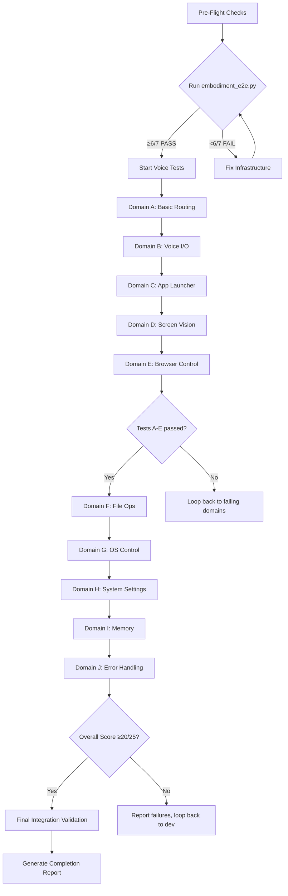

# SAGE / JARVIS — Embodiment Testing: Master Test Plan

**Orchestrator**: AgentsOrchestrator  
**Date**: 2026-06-06  
**Phase**: Embodiment Validation Gate (~95% embodiment complete → production readiness)  
**Scope**: 25 voice commands across all 7 Tier 1 embodiment tools + core agent routing + HUD

---

## 1. Pre-Flight Checklist

### 1.1 Infrastructure Verification

| # | Check | How to Verify | Owner |
|---|-------|---------------|-------|
| 1 | Ollama running at localhost:11434 | `curl localhost:11434/api/tags` | Operator |
| 2 | Whisper service at port 8081 | `curl http://localhost:8081/health` | Operator |
| 3 | Python 3.11+ available | `python --version` | Operator |
| 4 | All dependencies installed | `pip list \| findstr /i "sounddevice numpy edge-tts pyautogui pyperclip PyQt6 playwright psutil"` | Operator |
| 5 | Playwright browsers installed | `python -m playwright install chromium` | Operator |
| 6 | Microphone functional | `python -c "import sounddevice; print(sounddevice.query_devices())"` | Operator |
| 7 | Speakers/headphones functional | Manual audio test | Operator |
| 8 | ffmpeg on PATH (for TTS) | `ffmpeg -version` | Operator |
| 9 | `C:\jarvis` on filesystem | `dir C:\jarvis` | Operator |
| 10 | SQLite interactions DB writable | `python -c "from tools.observability.interaction_logger import init_db; init_db(); print('OK')"` | Operator |

### 1.2 Service Health Check

| # | Service | Expected | Owner |
|---|---------|----------|-------|
| 1 | Ollama responds | `python sage.py --providers` shows `OK ollama/llama3.2` | Operator |
| 2 | Whisper responds | `python tests/embodiment_e2e.py` test 3 passes | Operator |
| 3 | Existing E2E suite passes | `python sage.py --test` returns ≥6/7 pass | Operator |
| 4 | UI launches (optional) | `python sage.py --ui` window appears with SAGE header | Operator |

### 1.3 Test Environment Setup

| Action | Command | Owner |
|--------|---------|-------|
| Create test results directory | `mkdir C:\jarvis\test_results\` | Operator |
| Create test log file | `type nul > C:\jarvis\test_results\voice_test_results_YYYYMMDD.csv` | Operator |
| Install dependencies if missing | `pip install sounddevice numpy edge-tts pyautogui pyperclip PyQt6 psutil` | Operator |
| Set PYTHONPATH | `$env:PYTHONPATH = "C:\jarvis"` | Operator |

---

## 2. Voice Commands to Run (25 Total)

### Domain A: Basic Routing & Conversation (4 commands)

**Test A1 — Simple Greeting**
| Field | Value |
|-------|-------|
| **Voice Command** | "Hello" |
| **Expected Route** | Commander → conversational (bypasses agent routing) |
| **Expected Response** | "Hello! I'm Sage, your AI assistant. How can I help you today?" |
| **Pipeline Latency** | < 2 seconds (local, no LLM call) |
| **PASS if** | Correct response received within timeout |
| **FAIL if** | Agent routing attempted, LLM error, or wrong response |
| **Owner** | Commander Agent QA |

**Test A2 — Research Question**
| Field | Value |
|-------|-------|
| **Voice Command** | "What is Python?" |
| **Expected Route** | Commander → Researcher Agent |
| **Expected Response** | JSON with summary, key_findings, sources |
| **Pipeline Latency** | < 30 seconds (Ollama call) |
| **PASS if** | Structured research response returned with findings |
| **FAIL if** | Falls through to tool_operator, empty response, or error |
| **Owner** | Researcher Agent QA |

**Test A3 — Code Generation**
| Field | Value |
|-------|-------|
| **Voice Command** | "Write a Python function to calculate fibonacci numbers" |
| **Expected Route** | Commander → Engineer Agent |
| **Expected Response** | Code block with explanation |
| **Pipeline Latency** | < 60 seconds (Ollama code gen) |
| **PASS if** | Valid Python code returned with explanation field |
| **FAIL if** | Returns tool_operator route, no code, or broken JSON |
| **Owner** | Engineer Agent QA |

**Test A4 — Planning Request**
| Field | Value |
|-------|-------|
| **Voice Command** | "Plan a three-step process to organize my desktop" |
| **Expected Route** | Commander → Planner Agent |
| **Expected Response** | JSON with steps array and summary |
| **PASS if** | Structured plan with 3+ steps returned |
| **FAIL if** | No steps property, empty response, routing failure |
| **Owner** | Planner Agent QA |

---

### Domain B: Voice I/O Pipeline (4 commands)

**Test B1 — Microphone Detection**
| Field | Value |
|-------|-------|
| **Voice Command** | (any — run `python tests/embodiment_e2e.py` test 2) |
| **Expected Behavior** | `_find_best_mic()` returns valid device index ≥ 0 |
| **PASS if** | Test reports PASS with device name |
| **FAIL if** | No input device found |
| **Owner** | Voice I/O QA |

**Test B2 — Whisper Service Health**
| Field | Value |
|-------|-------|
| **Voice Command** | (run `python tests/embodiment_e2e.py` test 3) |
| **Expected Behavior** | Whisper at 8081 responds with transcribed text |
| **PASS if** | Test reports PASS (empty transcription for silence is OK) |
| **FAIL if** | Connection refused / timeout |
| **Owner** | Voice I/O QA |

**Test B3 — Full Voice Loop (end-to-end)**
| Field | Value |
|-------|-------|
| **Voice Command** | "What time is it?" (spoken into microphone) |
| **Expected Pipeline** | Mic → Whisper → Commander → Tool Operator → Response → TTS → Speaker |
| **Expected Response** | Conversational response about current time |
| **PASS if** | Voice is transcribed, SAGE responds, TTS plays audio |
| **FAIL if** | Any stage fails (mic, whisper, LLM, TTS) |
| **Owner** | Voice I/O QA |
| **Risk** | Picks up background noise; speak clearly in quiet room |

**Test B4 — Continuous Voice Loop**
| Field | Value |
|-------|-------|
| **Voice Command** | Two consecutive commands: "Say hello" then "What is 2+2?" |
| **Expected Behavior** | After first response, mic re-opens and listens for second command |
| **SECOND Expected Response** | Math answer (or routed to tool_operator) |
| **PASS if** | Both commands processed in sequence without manual restart |
| **FAIL if** | Loop exits after first command, or second command not recognized |
| **Owner** | Voice I/O QA |

---

### Domain C: Application Launcher (3 commands)

**Test C1 — Launch Calculator (Voice)**
| Field | Value |
|-------|-------|
| **Voice Command** | "Open calculator" |
| **Expected Route** | Commander → Tool Operator → open_app("calculator") |
| **Expected Behavior** | Windows calc.exe launches |
| **Pass/Fail Evidence** | Task Manager shows calc.exe OR calc window visible |
| **PASS if** | Calculator window appears within 5 seconds |
| **FAIL if** | "Could not confirm that calculator launched" or app not found |
| **Owner** | Tool Operator QA |

**Test C2 — Launch Notepad (Voice)**
| Field | Value |
|-------|-------|
| **Voice Command** | "Open notepad" |
| **Expected Behavior** | notepad.exe launches |
| **PASS if** | Notepad window visible within 5 seconds |
| **FAIL if** | Launch fails or returns "not found" |
| **Owner** | Tool Operator QA |

**Test C3 — Launch Unknown App (Error Handling)**
| Field | Value |
|-------|-------|
| **Voice Command** | "Open foobar nonexistent application" |
| **Expected Behavior** | Graceful error — does not crash |
| **Expected Response** | "Could not confirm that foobar launched..." or similar |
| **PASS if** | Returns error message without crashing SAGE |
| **FAIL if** | Pipeline crashes, unhandled exception, or infinite hang |
| **Owner** | Tool Operator QA |

---

### Domain D: Screen Vision (2 commands)

**Test D1 — Screen Description**
| Field | Value |
|-------|-------|
| **Voice Command** | "What's on my screen?" |
| **Expected Route** | Commander → Tool Operator → screen_vision |
| **Expected Response** | Description of current screen content |
| **Pipeline** | Screenshot → vision provider → description returned |
| **PASS if** | Non-empty description returned (even if "I can see desktop with icons") |
| **FAIL if** | "Vision provider not available", error, or timeout > 30s |
| **Owner** | Vision Provider QA |
| **Note** | Requires display. Vision uses OpenAI GPT-4o (vision) or Ollama fallback |

**Test D2 — Screen Question**
| Field | Value |
|-------|-------|
| **Voice Command** | "Is there a browser window open on my screen?" |
| **Expected Behavior** | Vision analyzes screenshot and responds based on current screen state |
| **PASS if** | Returns a relevant answer (yes/no + description) |
| **FAIL if** | Generic response, not actually analyzing screen |
| **Owner** | Vision Provider QA |

---

### Domain E: Browser Control (4 commands)

**Test E1 — Navigate to URL**
| Field | Value |
|-------|-------|
| **Voice Command** | "Open google.com" |
| **Expected Route** | Commander → Tool Operator → browser_control(go_to, "https://google.com") |
| **Expected Behavior** | Chrome launches (or default browser) and navigates to Google |
| **PASS if** | Browser opens and loads google.com |
| **FAIL if** | "Could not start browser session", Playwright error, or timeout |
| **Owner** | Browser Control QA |
| **Requires** | Internet connection, Playwright browsers installed |

**Test E2 — Web Search**
| Field | Value |
|-------|-------|
| **Voice Command** | "Search for latest AI news" |
| **Expected Behavior** | browser_control(search, "latest AI news") on default search engine |
| **PASS if** | Search results page loads |
| **FAIL if** | Navigation fails or browser doesn't respond |
| **Owner** | Browser Control QA |

**Test E3 — Browser Tab Management**
| Field | Value |
|-------|-------|
| **Voice Command** | "Open a new tab" |
| **Expected Behavior** | browser_control(new_tab) opens blank tab |
| **PASS if** | New tab opens in existing browser session |
| **FAIL if** | No response or tab not created |
| **Owner** | Browser Control QA |

**Test E4 — Browser Screenshot**
| Field | Value |
|-------|-------|
| **Voice Command** | "Take a screenshot of the browser" |
| **Expected Behavior** | browser_control(screenshot) captures page |
| **PASS if** | Screenshot file saved to desktop |
| **FAIL if** | Screenshot action fails or file not found |
| **Owner** | Browser Control QA |

---

### Domain F: File Operations (3 commands)

**Test F1 — List Files on Desktop (LOW risk)**
| Field | Value |
|-------|-------|
| **Voice Command** | "List files on my desktop" |
| **Expected Route** | Commander → Tool Operator → file_controller(list, "desktop") |
| **Expected Behavior** | Returns list of files/dirs in user's Desktop folder |
| **PASS if** | Directory listing returned (even if empty) |
| **FAIL if** | Access denied, error, or "unknown action" |
| **Owner** | File Controller QA |
| **Note** | LOW risk — auto-executes, no approval required |

**Test F2 — Create a Test File (MEDIUM risk)**
| Field | Value |
|-------|-------|
| **Voice Command** | "Create a file called test.txt on my desktop" |
| **Expected Route** | file_controller(create_file, "desktop", name="test.txt") |
| **Expected Response** | "File created: test.txt" |
| **PASS if** | File exists at C:\Users\<user>\Desktop\test.txt |
| **FAIL if** | "requires approval" returned and approval gate not surfaced to user |
| **Owner** | File Controller QA |
| **Note** | Verify clean-up: delete test.txt after test passes |

**Test F3 — Delete Operation (HIGH risk — Approval Gate)**
| Field | Value |
|-------|-------|
| **Voice Command** | "Delete the test.txt file on my desktop" |
| **Expected Response** | "File operation 'delete' requires approval. Awaiting user confirmation." |
| **PASS if** | Approval gate triggered — file NOT deleted without explicit confirmation |
| **FAIL if** | File deleted immediately without approval |
| **Owner** | File Controller QA / Security |
| **Clean-up** | (File should still exist — verify it's intact) |

---

### Domain G: OS Control / Computer Control (3 commands)

**Test G1 — Mouse Click (HIGH risk — Approval Gate)**
| Field | Value |
|-------|-------|
| **Voice Command** | "Click the center of the screen" |
| **Expected Response** | "OS control action 'click' requires approval." |
| **PASS if** | Approval gate triggered, action not executed automatically |
| **FAIL if** | Mouse moves/clicks without user confirmation |
| **Owner** | OS Control QA / Security |

**Test G2 — Type Text (HIGH risk — Approval Gate)**
| Field | Value |
|-------|-------|
| **Voice Command** | "Type 'hello world'" |
| **Expected Response** | "OS control action 'type' requires approval." |
| **PASS if** | Approval gate triggered for type action |
| **FAIL if** | Text typed into active window without approval |
| **Owner** | OS Control QA / Security |

**Test G3 — Focus Window**
| Field | Value |
|-------|-------|
| **Voice Command** | "Focus on the browser window" |
| **Expected Behavior** | computer_control(focus_window, "browser" or "chrome") |
| **PASS if** | Browser window comes to foreground |
| **FAIL if** | Returns "unknown action" or "focus_window failed" |
| **Owner** | OS Control QA |

---

### Domain H: System Settings (3 commands)

**Test H1 — Volume Up**
| Field | Value |
|-------|-------|
| **Voice Command** | "Turn up the volume" |
| **Expected Route** | Commander → Tool Operator → computer_settings(volume_up) |
| **Expected Behavior** | System volume increases (verify via speaker icon in taskbar) |
| **PASS if** | Volume visibly increases (5 steps) |
| **FAIL if** | "Unknown action" or no change |
| **Owner** | System Settings QA |

**Test H2 — Mute**
| Field | Value |
|-------|-------|
| **Voice Command** | "Mute the sound" |
| **Expected Behavior** | System volume mutes |
| **PASS if** | Speaker icon shows muted state |
| **FAIL if** | No change or error |
| **Owner** | System Settings QA |

**Test H3 — Volume Set (Precise Value)**
| Field | Value |
|-------|-------|
| **Voice Command** | "Set volume to 50 percent" |
| **Expected Behavior** | computer_settings(volume_set, value=50) |
| **PASS if** | Volume set to approximately 50% |
| **FAIL if** | Error or no change |
| **Owner** | System Settings QA |
| **Note** | Volume falls back to keyboard press if pycaw unavailable |

---

### Domain I: Memory & Context (2 commands)

**Test I1 — Remember Preference**
| Field | Value |
|-------|-------|
| **Voice Command** | "Remember that I prefer dark mode" |
| **Expected Route** | Commander → Memory Coordinator → store in Chroma/SQLite |
| **Expected Response** | "Memory updated: 1 category(ies)." |
| **PASS if** | Memory is stored (Chroma or JSON fallback) |
| **FAIL if** | "Memory analysis failed" or not routed to memory_coordinator |
| **Owner** | Memory Coordinator QA |

**Test I2 — Recall Stored Memory**
| Field | Value |
|-------|-------|
| **Voice Command** | "What do you remember about my preferences?" |
| **Expected Route** | Commander → Memory Coordinator → retrieve from Chroma |
| **Expected Response** | Response referencing dark mode preference |
| **PASS if** | Retrieves previous memory about dark mode |
| **FAIL if** | "No memory stored yet" or generic response |
| **Owner** | Memory Coordinator QA |

---

### Domain J: Error Handling & Edge Cases (2 commands)

**Test J1 — Empty/Background Noise**
| Field | Value |
|-------|-------|
| **Voice Command** | (Stay silent — let VAD timeout trigger) |
| **Expected Behavior** | record_audio returns None after silence_duration |
| **Response** | "No speech detected" → loop continues (in continuous mode) |
| **PASS if** | Sage does not crash, loop continues gracefully |
| **FAIL if** | Exception, crash, or hang |
| **Owner** | Voice I/O QA |

**Test J2 — Unrecognized Command**
| Field | Value |
|-------|-------|
| **Voice Command** | "asdfghjkl" (random keystrokes) |
| **Expected Behavior** | Whisper transcribes gibberish → routed to tool_operator → graceful response |
| **Expected Response** | "I couldn't process that request. Could you rephrase?" |
| **PASS if** | Graceful error returned, no crash |
| **FAIL if** | Unhandled exception or pipeline hangs |
| **Owner** | Tool Operator QA |

---

## 3. Test Execution Protocol

### 3.1 How to Run Each Test

1. **Prepare**: Ensure all pre-flight checks pass
2. **Execute**: Speak the voice command clearly into the microphone (or simulate with text mode)
3. **Observe**:
   - What does Sage say back? (transcribed in console)
   - Does the action execute? (app opens, browser navigates, etc.)
   - Are there any console errors?
   - How long does it take?
4. **Record**: Log results in `test_results/voice_test_results_YYYYMMDD.csv`

### 3.2 Results Tracking Format

```csv
test_id,domain,command,expected_route,actual_route,expected_success,actual_success,latency_ms,pass_fail,notes
A1,conversation,"Hello",commander,commander,True,True,150,PASS,
B3,voice,"What time is it?",voice_loop,voice_loop,True,True,3200,PASS,"TTS played clearly"
C2,apps,"Open notepad",open_app,open_app,True,True,2400,PASS,"Notepad opened"
E1,browser,"Open google.com",browser_control,browser_control,True,False,15000,FAIL,"Playwright timeout - check browser install"
F3,files,"Delete test.txt",file_controller,file_controller,True,True,800,PASS,"Approval gate triggered - file safe"
G1,os,"Click center",computer_control,computer_control,True,True,500,PASS,"Approval gate triggered"
```

### 3.3 Test Result Definitions

| Result | Definition |
|--------|------------|
| **PASS** | Command matched expected route, action executed (or approval gate triggered as expected), no crashes |
| **FAIL** | Wrong route, wrong response, action failed, unexpected error, or crash |
| **NEEDS REVIEW** | Partial success — worked but had minor issues (slow, wrong phrasing but intent achieved) |
| **BLOCKED** | Pre-requisite failed (e.g., Whisper not running) |

---

## 4. Success Criteria

### 4.1 Gate Requirements

| Gate | Requirement | Equivalent |
|------|-------------|------------|
| **Critical Gate** | 8/10 Domain A-D tests must PASS | Voice pipeline, routing, app launcher, vision must work |
| **Full Gate** | 20/25 total tests must PASS | Combined across all domains |
| **Safety Gate** | All HIGH-risk tests (F3, G1, G2) must trigger approval gates | No destructive action without approval |
| **Stability Gate** | Zero crashes across all 25 tests | Pipeline must be resilient |

### 4.2 Pass/Fail Criteria Per Domain

| Domain | Tests | Required Passes | Owner |
|--------|-------|-----------------|-------|
| A — Basic Routing | 4 | 3/4 | Commander QA |
| B — Voice I/O | 4 | 3/4 | Voice I/O QA |
| C — App Launcher | 3 | 3/3 | Tool Operator QA |
| D — Screen Vision | 2 | 1/2 | Vision QA |
| E — Browser Control | 4 | 3/4 | Browser Control QA |
| F — File Operations | 3 | 2/3 | File Controller QA |
| G — OS Control | 3 | 2/3 | OS Control QA |
| H — System Settings | 3 | 2/3 | System Settings QA |
| I — Memory | 2 | 2/2 | Memory Coordinator QA |
| J — Error Handling | 2 | 2/2 | Stability QA |

### 4.3 Overall Verdict

| Verdict | Criteria |
|---------|----------|
| **SHIP READY** | ≥20/25 PASS, all HIGH-risk gates verified, zero crashes |
| **CONDITIONAL** | 15-19/25 PASS, HIGH-risk gates verified, non-critical failures |
| **NEEDS WORK** | <15/25 PASS, or any HIGH-risk gate not functioning |
| **BLOCKED** | Infrastructure failures (Whisper, Ollama) prevent testing |

---

## 5. Risk Register

| # | Risk | Likelihood | Impact | Mitigation |
|---|------|------------|--------|------------|
| 1 | Whisper service not running | Medium | Blocks all voice tests | Pre-flight check B2; fall back to text mode for verbal commands |
| 2 | Ollama not responding | Medium | Blocks A2-A4 (research, code, plan) | Pre-flight check; use `python sage.py --providers` |
| 3 | Microphone unresponsive | Low | Blocks B1-B4 | Use `sounddevice` query; check Windows sound settings |
| 4 | TTS fails (ffmpeg missing) | Medium | B3-B4 no audio output | Install ffmpeg or test with --text mode |
| 5 | Playwright browsers not installed | Medium | Blocks E1-E4 | `python -m playwright install chromium` |
| 6 | Gemini bridge imports in computer_control/settings | HIGH | Potential crash or wrong provider | **Known Issue** — computer_control.py and computer_settings.py import `gemini_bridge` (line 13-14) despite NO Gemini constraint; these must route through llm_client.py |
| 7 | File operations target wrong directory | Low | Unintended file changes | Safe path validation in file_controller.py restricts to home dir |
| 8 | Approval gate bypass in fast execution | Low | Destructive action without consent | All HIGH-risk tools go through `safe_*` wrappers in sage.py |

---

## 6. Ownership Matrix

| Test Group | Primary QA Owner | Dev Owner | Escalation Path |
|------------|------------------|-----------|-----------------|
| A — Basic Routing | EvidenceQA (Commander focus) | Commander Agent dev | Orchestrator |
| B — Voice I/O | EvidenceQA (Voice focus) | Voice I/O dev | Orchestrator |
| C — App Launcher | EvidenceQA (Apps focus) | Tool Operator dev | Orchestrator |
| D — Screen Vision | EvidenceQA (Vision focus) | Vision provider dev | Orchestrator |
| E — Browser Control | EvidenceQA (Browser focus) | Browser Control dev | Orchestrator |
| F — File Operations | testing-reality-checker | File Controller dev | Orchestrator / Security |
| G — OS Control | testing-reality-checker | Computer Control dev | Orchestrator / Security |
| H — System Settings | EvidenceQA (Settings focus) | Computer Settings dev | Orchestrator |
| I — Memory | EvidenceQA (Memory focus) | Memory Coordinator dev | Orchestrator |
| J — Error Handling | testing-reality-checker | All devs | Orchestrator |
| Pipeline Logging | Observability QA | Interaction Logger dev | Orchestrator |

### Agent Spawning Instructions

For each test group, spawn the appropriate QA agent:

```
# For groups A-E, H, I:
"Please spawn an EvidenceQA agent to run tests in domain [X] from C:\jarvis\docs\MASTER_TEST_PLAN.md. Use screenshot tools for visual evidence. Provide PASS/FAIL decision with specific feedback for each test."

# For groups F, G, J:
"Please spawn a testing-reality-checker agent to run tests in domain [X] from C:\jarvis\docs\MASTER_TEST_PLAN.md. Cross-validate all QA findings with comprehensive automated screenshots. Default to 'NEEDS WORK' unless overwhelming evidence proves readiness."
```

---

## 7. Remaining Work Items (Found During Code Review)

These issues were detected during pipeline analysis and should be tracked as post-testing fixes:

| # | Issue | File(s) | Severity |
|---|-------|---------|----------|
| 1 | **Gemini dependency in embodiment tools** — `computer_settings.py` and `computer_control.py` import `gemini_bridge` and call `generate_text`/`generate_with_vision` despite project NO-Gemini constraint | `tools/embodiment/computer_settings.py:11-13`, `tools/embodiment/computer_control.py:13-14` | HIGH — must route to `llm_client.py` |
| 2 | **Legacy API key config** — `computer_settings.py:_get_api_key()` reads from `config/api_keys.json` (legacy path, not Vault) | `tools/embodiment/computer_settings.py:35-38` | MEDIUM |
| 3 | **Vision provider untested** — `vision/__init__.py` provider abstraction exists but no E2E test for actual screen capture + provider call | `tools/embodiment/vision/` | MEDIUM |
| 4 | **TTS ffmpeg dependency** — voice TTS uses ffmpeg for mp3→pcm conversion; fallback (default media player) is poor UX | `tools/embodiment/voice_io.py:249-269` | LOW |
| 5 | **No approval gate UI in HUD** — approval gates return text responses but PyQt6 HUD has no approval dialog | `ui.py`, `sage.py:172-190` | MEDIUM |

---

## 8. Execution Workflow



---

*Prepared by AgentsOrchestrator on 2026-06-06*
*Based on analysis of: sage.py, ROADMAP.md, PHASE2_EMBODIMENT_PLAN.md, kimi-2006.md, OPERATOR_CHECKLIST.md, OPERATOR_WORKFLOW.md, capability_registry.py, voice_io.py, open_app.py, browser_control.py, file_controller.py, computer_control.py, computer_settings.py, ui.py, agents/*.py, tools/observability/*.py, tests/embodiment_e2e.py*
